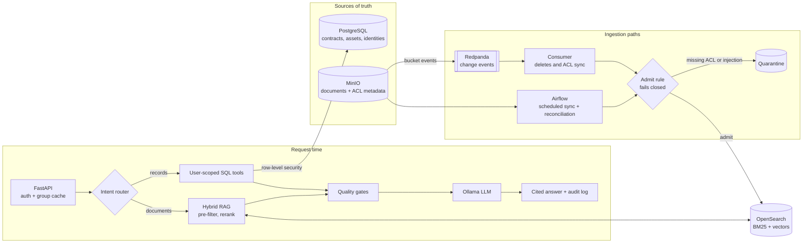

# Enterprise RAG with access control

[](https://github.com/henrymbuguak/enterprise-rag-access-control/actions/workflows/ci.yml)
[](LICENSE)
[](https://www.python.org/downloads/release/python-3110/)
[](docker-compose.yml)
[](https://opensearch.org/)

A working, open-source implementation of a permission-aware enterprise AI assistant. It answers questions from documents and databases, and every answer respects who is asking: a user who can't see a document in the source system can't get it through the AI either.

The project implements the **Brimmora** reference architecture, a case study of a fictional manufacturer, on your laptop with Docker. Brimmora, its users, and its documents are illustrative.

📖 Case study: [Building Brimmora's enterprise AI platform](https://hlab.tech/posts/enterprise-ai-platform-reference-architecture/)

## What it demonstrates

Each control in the case study runs here and is proven by an automated check.

| Control | How it works here | Code |
| --- | --- | --- |
| Fail-closed ingestion | Documents without ACL tags or a classification never reach the index; they go to a counted quarantine | `ingest.py` |
| Event-driven deletes and ACL sync | MinIO bucket events flow through Redpanda; deletes and permission changes reach the index in seconds | `consumer.py` |
| Nightly reconciliation | A scheduled job removes index entries whose source no longer exists | `dags/`, `ingest.py` |
| Hybrid retrieval | BM25 and vector search in OpenSearch, merged and reranked by a cross-encoder | `search.py` |
| Filter inside the search | ACL, deletion, region, and tenant filters run inside the k-NN query, never after it | `search.py` |
| Query routing | Questions go to documents (RAG), to curated SQL tools, or to both | `router.py` |
| User-scoped tools | Tools run as the user under PostgreSQL row-level security; the model never writes SQL | `tools.py`, `seed/sql/` |
| Quality gates | No evidence, no answer: enough context, citable, authorized, and fresh, or the model is never called | `answer.py` |
| Prompt-injection defenses | Ingestion scan, retrieved text treated as data, read-only tools, output checks | `ingest.py`, `answer.py` |
| Audit trail | Every answer records user, groups, route, tool calls, chunk versions, and model | `answer.py` |
| Evaluation | A golden set with route, retrieval, grounding, and refusal metrics, plus judge calibration | `evaluate.py`, `eval/` |
| Monitoring | Prometheus metrics and a Grafana dashboard for freshness, gates, quarantine, and cost | `metrics.py`, `monitoring/` |
| CI/CD | Security regression tests, secret scan, SBOM, vulnerability scan, OPA policies, eval gate | `.github/workflows/ci.yml` |

## Architecture



## Quick start

### Prerequisites

- 16 GB RAM and 20 GB free disk. In Docker Desktop, give Docker at least 10 GB of memory (Settings, then Resources).
- Docker Desktop, or Docker Engine with Compose 2.24 or later.
- `make`, `git`, `curl`, and `jq`.
- **macOS:** [Ollama](https://ollama.com) installed natively, so the model can use the GPU.
- **Linux:** Ollama runs in Docker. Run `sudo sysctl -w vm.max_map_count=262144` once, or OpenSearch won't start.
- **Windows:** use WSL2 and follow the Linux steps.

The first run downloads about 10 GB of images, packages, and models.

### 1. Clone and configure

```bash
git clone https://github.com/henrymbuguak/enterprise-rag-access-control.git
cd enterprise-rag-access-control
make setup
```

`make setup` creates `.env` from `.env.example`. Then open `.env` and set the services to run:

| Platform | `COMPOSE_PROFILES` | `OLLAMA_URL` |
| --- | --- | --- |
| macOS | `api,airflow,events,monitoring` | `http://host.docker.internal:11434` (the default) |
| Linux or Windows | `ollama,api,airflow,events,monitoring` | `http://ollama:11434` |

`airflow` adds the scheduled path and builds a 3 GB image. Leave it out if you only want to try the assistant.

### 2. Start everything

On macOS, start the Ollama app first. Then:

```bash
make up
make seed
make index-init
make sync
make pull-model
make wait-api
```

| Command | What it does |
| --- | --- |
| `make up` | Builds the images and starts every service in `COMPOSE_PROFILES` |
| `make seed` | Uploads 11 synthetic documents to MinIO; Postgres seeds itself on first start |
| `make index-init` | Creates the OpenSearch index, alias, and hybrid search pipeline |
| `make sync` | Indexes the corpus; two trap documents land in quarantine, as designed |
| `make pull-model` | Downloads `llama3.1:8b` (about 4.7 GB) |
| `make wait-api` | Waits until the API is ready |

### 3. Ask a question

Open **http://localhost:8000** and switch between users to watch access control at work. Or use the command line:

```bash
make ask AS=bob Q="What caused error E-4472?"
make ask AS=dave Q="What caused error E-4472?"
```

bob, a maintenance engineer, gets a cited answer. dave works in the warehouse and gets the no-evidence message, because he isn't allowed to see the incident report.

| User | Groups | Can see |
| --- | --- | --- |
| alice | procurement | Contracts, spend, company-wide documents |
| bob | East Plant maintenance | Manuals, incident reports, bulletins, assets |
| carol | maintenance + engineering-confidential | Everything bob sees, plus restricted turbine designs |
| dave | all employees only | Company-wide policies and procedures |

Every answer has a `request_id`. Replay how it was produced from the audit log:

```bash
make trace ID=<request_id>
```

### 4. Prove it works

```bash
make check-16
```

This runs 10 end-to-end tests: event-driven freshness, ACL change, and delete; unauthorized access; structured routing; hybrid retrieval; no evidence; monitoring; ACL drift; reconciliation; prompt injection; and audit trace. Expect `ALL PASSED (15/15)` in a few minutes.

## Services

| Service | Role | URL |
| --- | --- | --- |
| API and web UI | Answer service | http://localhost:8000 |
| MinIO console | Document store (SharePoint stand-in) | http://localhost:9001 (brimmora / brimmora-secret) |
| OpenSearch | Retrieval index | http://localhost:9200 |
| Airflow | Scheduled path | http://localhost:8080 (password: `docker compose exec airflow cat /opt/airflow/standalone_admin_password.txt`) |
| Grafana | Dashboard "Brimmora AI Platform" | http://localhost:3000 |
| Prometheus | Metrics | http://localhost:9090 |
| Postgres | Structured data, identities, audit log | localhost:5432 |

## Everyday commands

| Command | Purpose |
| --- | --- |
| `make ask AS=<user> Q="<question>"` | Ask as a user |
| `make explain AS=<user> Q="<question>"` | Compare BM25, vector, hybrid, and reranked results |
| `make set-acl KEY=<object> TAGS=<groups>` | Change a document's ACL and watch it propagate |
| `make eval` | Run the golden-set evaluation |
| `make test` | Run the security regression tests |
| `make policy` | Run the OPA policies |
| `make check-NN` | Run one phase's checks, `00` to `16` |
| `make logs S=<service>` | Follow a service's logs |
| `make down` | Stop everything; data is kept |
| `make reset` | Stop everything and delete all data |

## Project layout

```text
app/brimmora/        the platform: ingestion, search, routing, answers, API, checks
dags/                Airflow DAG for the scheduled path
eval/                golden question set and quality thresholds
monitoring/          Prometheus config and the Grafana dashboard
policy/              OPA policies enforced in CI
seed/sql/            schema, row-level security policies, seed data
tests/               security regression tests
docker-compose.yml   every service, switched on by COMPOSE_PROFILES
```

## Continuous integration

Every push runs four jobs:

1. **Unit and security tests** against a real Postgres, including row-level security and the fail-closed admit rule.
2. **Supply chain:** Gitleaks secret scan, Syft SBOM, Trivy vulnerability scan, and OPA policy checks.
3. **RAG evaluation:** brings up the stack with Ollama and fails the build if any golden-set metric drops below its threshold.
4. **Publish:** on `main`, pushes the API image to GitHub Container Registry.

The evaluation job runs an 8B model on a CPU-only runner and takes 30 to 60 minutes.

## Troubleshooting

| Symptom | Fix |
| --- | --- |
| `Docker is not running` | Start Docker Desktop and wait until the engine is running |
| `WARNING: .env is missing settings` | `cp .env.example .env`, then set `COMPOSE_PROFILES` again |
| OpenSearch exits on Linux | `sudo sysctl -w vm.max_map_count=262144` |
| `pull access denied for minio/minio` | MinIO stopped publishing images; this project uses the `pgsty/minio` community fork. Pull the latest `docker-compose.yml` |
| New documents never become searchable | Check `docker compose ps consumer`; `events` must be in `COMPOSE_PROFILES` |
| Everyone gets the no-evidence message | Inspect a request with `make trace`; lower `MIN_RELEVANCE` in `.env` if the reranker scores are low |
| Containers exit with code 137 | Give Docker more memory, or set `LLM_MODEL=llama3.2:3b` |

## Going to production

This build keeps every control but simplifies the infrastructure: one region, one OpenSearch node, in-process caches, and a development token endpoint. The case study describes the production equivalents, including Entra ID, SharePoint change notifications, Redis, per-region indexes, and Kubernetes. `DEV_MODE=true` exposes token and audit endpoints for local use; never enable it in a shared environment.

## License

[MIT](LICENSE) © 2026 Henry Mbugua
